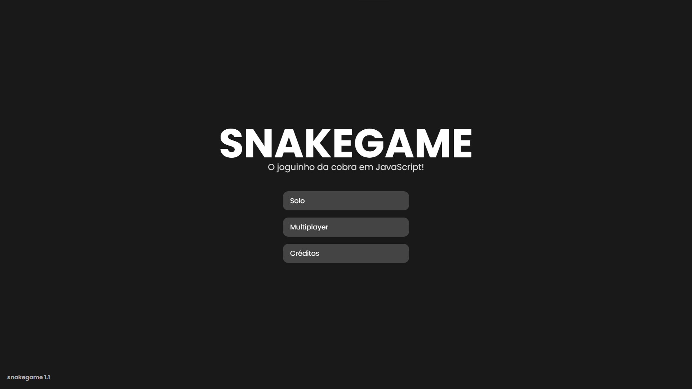
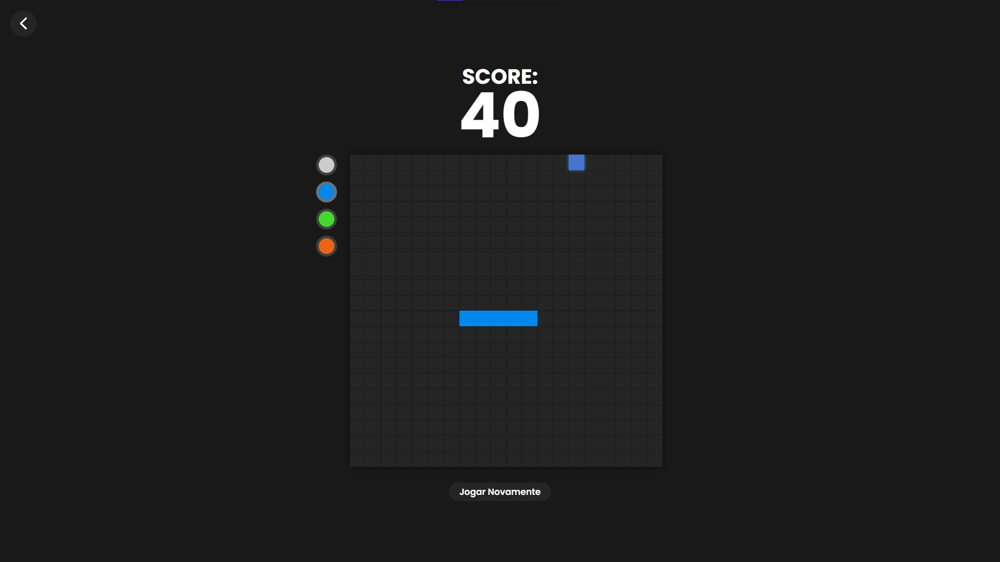
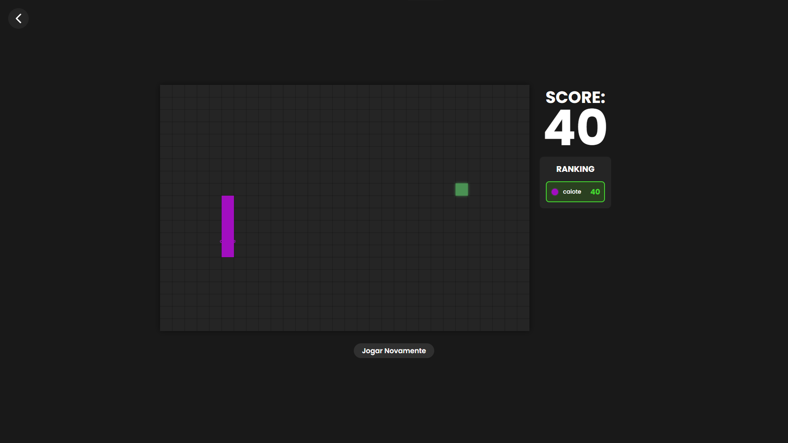

# SNAKEGAME - ᴘᴛ

O jogo da cobrinha classico feito em Html, Css e JavaScript, feito com intuito de estudos! Também com versão multiplayer usando WebSocket.
Clone o repositório ou acesse o deploy para jogar:<br/>
https://snakegame-one-opal.vercel.app

## Capturas de Telas







## Objetivos

Este projeto nasceu de uma vontade de aprender e evoluir. Os principais objetivos por trás dele são:

- Aprofundar o entendimento de JavaScript puro, manipulação de Canvas, game loops e comunicação em tempo real com WebSocket
- Demonstrar capacidade de construir uma aplicação completa do zero, com frontend, servidor HTTP e servidor WebSocket integrados
- Disponibilizar o código de forma aberta para que outras pessoas possam estudar, contribuir e se inspirar

### Servidores

- **HTTP Server**: Porta 3000 (servindo os arquivos HTML/CSS/JS)
- **WebSocket Server**: Porta 8080 (gerenciando o jogo multiplayer)

## Dependências

O projeto foi desenvolvido com as seguintes dependências:

- **[HTML](https://svelte.dev)** – HTML5
- **[CSS](https://vite.dev)** – CSS3
- **[JavaScript](https://threejs.org)** – ECMAScript 2024
- **WebSocket** - (biblioteca `ws` para comunicação em tempo real)
- **[Node.js](https://nodejs.org/pt)** para os servidores

## Como Rodar Localmente

### Pré-requisitos

- [Node.js](https://nodejs.org) instalado

### 1. Clone o repositório

```bash
git clone https://github.com/seu-usuario/snakegame.git
cd snakegame
```

### 2. Instale as dependências

```bash
npm install
```

### 3. Inicie os servidores

Em dois terminais separados:

```bash
# Terminal 1 — servidor HTTP
npm start

# Terminal 2 — servidor WebSocket (multiplayer)
npm run server
```

### 4. Acesse no navegador

```
http://localhost:3000
```

# SNAKEGAME - ᴇɴ

The classic Snake game built with HTML, CSS, and JavaScript for educational purposes! It also includes a multiplayer version using WebSockets.
Clone the repository or visit the live deployment to play:<br/>
https://snakegame-one-opal.vercel.app

## Screenshots


## Objectives

This project was born out of a desire to learn and grow. The main objectives behind this project are:

- To deepen the understanding of vanilla JavaScript, Canvas manipulation, game loops, and real-time communication via WebSockets
- To demonstrate the ability to build a complete application from scratch, integrating a frontend, an HTTP server, and a WebSocket server
- To make the code open-source so others can study, contribute, and find inspiration

### Servers

- **HTTP Server**: Port 3000 (serving HTML/CSS/JS files)
- **WebSocket Server**: Port 8080 (managing the multiplayer game)

## Dependencies

The project was developed using the following dependencies:

- **HTML** – HTML5
- **CSS** – CSS3
- **JavaScript** – ECMAScript 2024
- **WebSocket** - (`ws` library for real-time communication)
- **[Node.js](https://nodejs.org)** for the servers

## How to Run Locally

### Prerequisites

- [Node.js](https://nodejs.org) installed

### 1. Clone the repository

```bash
git clone https://github.com/your-username/snakegame.git
cd snakegame
```

### 2. Install dependencies

```bash
npm install
```

### 3. Start the servers

In two separate terminals:

```bash
# Terminal 1 — HTTP server
npm start

# Terminal 2 — WebSocket server (multiplayer)
npm run server
```

### 4. Access in your browser

```
http://localhost:3000
```

by caiothedev<br/>
#snakegame #html #css #javascript #websocket